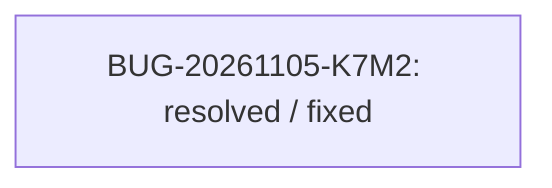

<!-- GENERATED, DO NOT EDIT: regenerado por /reversa-debugger-graph em 2026-11-05T21:18:27.876462+00:00 a partir de 1 bugs -->

O cliente chamava uma rota DELETE ausente. A rota foi implementada e testada.
