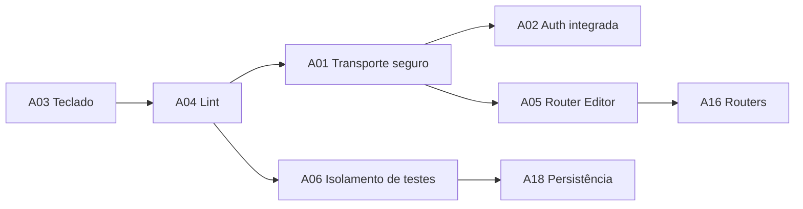

# Forward — Plano de ação Cue Studio (2026-10-04)

Origem: auditoria em [diagnostico.md](../../_reversa_sdd/auditoria-2026-10-04/diagnostico.md) e [plano-de-acao.md](../../_reversa_sdd/auditoria-2026-10-04/plano-de-acao.md) — versão **2.5.2**, commit **27cadae**.

Esta pasta materializa o **primeiro ciclo** do plano em formato executável pelo pipeline Reversa. Cada ação da auditoria virou uma *feature* (arquivo `0X-feature-*.md`) com requirements, plano, contrato, teste de aceitação e critério de pronto.

## Política

- `.reversa/reversa-config.json` está em `allowLegacyEdits: false`, `allowedPaths: []`.
- Esta pasta escreve **apenas** dentro de `_reversa_forward/` (pasta própria do Reversa).
- Qualquer alteração em `app/`, `ui/`, `tests/`, `scripts/` exige que **você** edite `.reversa/reversa-config.json` para liberar paths específicos.
- Nenhum patch aqui é aplicado automaticamente. As specs descrevem a mudança; os protótipos rodam isolados para validar a estratégia antes da execução real.

## Backlog executivo (resumo das 24 ações da auditoria)

| ID | Prioridade | Resumo | Status aqui |
|---|---|---|---|
| A01 | P0 | Transporte HTTP com allowlist em vez de patch global de fetch | spec pronta em [`08-feature-a01-secure-http.md`](08-feature-a01-secure-http.md) |
| A02 | P0 (rede) | Política de autenticação integrada ao servidor geral | spec pronta em [`09-feature-a02-auth.md`](09-feature-a02-auth.md) |
| A03 | P0 | Teclado e foco de diálogos | spec pronta em [`07-feature-a03-keyboard.md`](07-feature-a03-keyboard.md) |
| A04 | P0 | Lint sem erros | spec pronta em [`10-feature-a04-lint.md`](10-feature-a04-lint.md) |
| A05 | P1 | Router Editor montado corretamente | spec pronta em [`11-feature-a05-editor-router.md`](11-feature-a05-editor-router.md) |
| A06 | P1 | Isolamento de testes e suítes explícitas | spec pronta em [`12-feature-a06-test-isolation.md`](12-feature-a06-test-isolation.md) |
| A07 | P1 | Mapa de jornadas e protótipos | pendente (UX) |
| A08 | P1 | Componentes compartilhados (diálogo, campo, erro, status) | pendente |
| A09 | P1 | Navegação com projeto persistente e URL | pendente |
| A10 | P1 | Projetos: criação rápida e setup progressivo | pendente |
| A11 | P1 | Dashboard de trabalho | pendente |
| A12 | P1 | Director: etapa, próxima ação, mobile | pendente |
| A13 | P1 | Studio com resultados acessíveis em mobile | pendente |
| A14 | P1 | Fila: ações coerentes e feedback de duração | pendente |
| A15 | P1 | Error Boundary por seção e erro HTTP padronizado | pendente |
| A16 | P1 | Routers por domínio | pendente (backend) |
| A17 | P1 | Separar contratos, slices, transporte e polling | pendente (frontend) |
| A18 | P1 | Matriz de persistência e migrações | pendente |
| A19 | P1 | Retomada de jobs após reinício | pendente |
| A20 | P2 | Reduzir bundle e requests | pendente |
| A21 | P2 | Densidade confortável/compacta | pendente |
| A22 | P2 | Alvos de toque 44 px | pendente |
| A23 | P2 | Foco visível e ARIA | pendente |
| A24 | P3 | Telemetria de runtime | pendente |
| A25 | P1 | Estado narrativo estruturado por plano (Shot IR + continuity check) | spec pronta em [`31-feature-a25-shot-ir.md`](31-feature-a25-shot-ir.md) — complementar ao ciclo UX, não substitui |

## Sequência recomendada para o ciclo 0



A03 e A04 são pequenas e independentes — podem ir primeiro. A01 destrava A02 (UI autenticada) e A15 (erros estruturados). A05 entra em paralelo porque é a assinatura de uma factory de router. A06 entra cedo para garantir que qualquer teste novo respeite isolamento de singletons.

## Como ler uma feature

Cada arquivo `0X-feature-*.md` segue o template abaixo:

1. **Contexto e referência** — trecho do diagnóstico + caminho do código-fonte previsto.
2. **Requisitos** — comportamento esperado, invariantes e fora de escopo.
3. **Contrato** — assinatura/forma JSON/Rota esperada.
4. **Plano de mudança** — sequência mínima, com reversão.
5. **Testes de aceitação** — comandos ou specs reproduzíveis.
6. **Critérios de pronto** — itens verificáveis pelo usuário.
7. **Riscos e mitigações** — incluindo o que **não** mexer.

## Protótipos e utilitários

- [`prototypes/`](prototypes/) — scripts isolados que demonstram a abordagem esperada sem tocar `app/` ou `ui/`. Servem para validar estratégia e dar confiança antes da implementação real.
- [`checklists/`](checklists/) — listas curtas para verificação manual (teclado, foco, contraste, etc.).

## Extensão complementar (ciclo 4) — eixos de produto

A partir de 2026-10-15, uma extensão complementar ataca seis eixos de produto que não estavam no escopo da auditoria original A01–A24: dependências explícitas, estado narrativo estruturado, perfil econômico, provenance, PT-BR e offline estrito. Esses eixos não substituem A01–A24; eles ampliam o escopo de capacidade do Cue Studio e podem entrar em v2.6 ou v3.0.

| ID | Eixo | Spec | Status |
|---|---|---|---|
| A25 | Shot IR + continuidade | [`31-feature-a25-shot-ir.md`](31-feature-a25-shot-ir.md) | ✅ spec + protótipo (7/7) || A25b | Continuidade entre famílias (R10) | [`41-feature-a25b-cross-family-continuity.md`](41-feature-a25b-cross-family-continuity.md) | ✅ Spec + protótipo (8/8) — fechando R10 || A26 | Dependências explícitas e propagação de impacto | [`35-feature-a26-dependencies.md`](35-feature-a26-dependencies.md) | ✅ spec + protótipo (7/7) |
| A26b | Retake com efeito real (correção bug R01) | [`34-feature-a26b-retake-dispatch.md`](34-feature-a26b-retake-dispatch.md) | ✅ spec + protótipo (9/9) — P0 do dossiê |
| A27 | ProvenanceManifest por Take | [`32-feature-a27-provenance.md`](32-feature-a27-provenance.md) | ✅ spec + protótipo (9/9) |
| A28 | Continuity Panel (visualização UX do A25) | [`33-feature-a28-continuity-panel.md`](33-feature-a28-continuity-panel.md) | ✅ spec + protótipo (7/7) |
| A29 | Perfil econômico 6–8 GB comprovado | [`38-feature-a29-economy-profile.md`](38-feature-a29-economy-profile.md) | ✅ spec + protótipo (8/8) |
| A30 | Corpus PT-BR para TTS | [`39-feature-a30-ptbr-corpus.md`](39-feature-a30-ptbr-corpus.md) | ✅ spec + protótipo (8/8) |
| A31 | Modo `--offline-strict` com auditoria | [`40-feature-a31-offline-strict.md`](40-feature-a31-offline-strict.md) | ✅ spec + protótipo (9/9) |
| A34 | CapabilityMatrix por modelo/runtime/modo | [`37-feature-a34-capability-matrix.md`](37-feature-a34-capability-matrix.md) | ✅ spec + protótipo (8/8) |
| R03 | Wizard tipado + MCP mutation_class | [`36-feature-r03-wizard-mcp.md`](36-feature-r03-wizard-mcp.md) | ✅ spec + protótipo (9/9) |

Mapeamento rápido contra o código atual (v2.5.2, verificado por grep):

- **A25 (Shot IR)**: `app/services/h3_story_ledger.py` v24 já tem `subject_continuity`, `setting_continuity`, `visual_continuity`, `_infer_h3_blocking_contract`. Faltam `hand_object`, `gaze`, `action_completed`, `object_state`, expor como schema editável e detector de inconsistências.
- **A25b (cross-family continuity / R10)**: H3 tem `_infer_h3_blocking_contract` + `Picture N` labels, mas Wan/LTX/LTX25/Hunyuan não têm adapter de continuidade. A25b introduz `ContinuityAdapter` (Protocol) com 5 adapters por família + fallback `IndependentFallbackAdapter` + `ContinuityRegistry` + `resolve_continuity()` orquestrando A34 + A25b + A25. Fecha o R10.
- **A26 (dependências)**: sem `impact_of`, sem DAG explícito. Verde, trabalho novo.
- **A26b (retake com efeito real)**: `production_resume.py:retake_stage()` tem `if False` no caminho efetivo; fachada apenas registra evento, **não despacha renderização**. Bug confirmado pelo dossiê seção 10. Spec + protótipo A26b cobrem a correção proposta com idempotência.
- **A27 (provenance)**: `editor_projects.py:1777` define `sidecar`, `checkpoint_compatibility.py` retorna receipt, `wgp.py` registra `queue_manifest`. Falta `ProvenanceManifest` unificado por Take com SHA-256 de artefatos, validação de adulteração, bundle portátil e integração com Storage Manager.
- **A28 (Continuity Panel)**: 6 regras do A25 funcionam no protótipo mas não há UI que exiba resultados. A28 entrega o painel.
- **A29 (economia)**: Auto-Tune funciona; sem obra de referência publicada, sem tempo medido, sem relatório versionado.
- **A30 (PT-BR)**: Chatterbox/Qwen3/Kokoro reconhecem `pt-br`; sem corpus de avaliação, sem dicionário de pronúncia.
- **A31 (offline)**: Allowlist de modelos existe; sem flag `--offline-strict`, sem auditoria de egress, sem CI offline.

## Smoke de integração validado

`prototypes/integration_smoke.py` encadeia os 11 protótipos do ciclo 4 em 12 passos contra a fixture `cue-reference-film-v1` ("A luz da oficina", 12 shots). Resultado: **12/12 PASS** sem GPU, sem FastAPI, sem app real. Como rodar:

```bash
cd /home/yuri/Documentos/cine_local/cue_studio
python3 _reversa_forward/plano-2026-10-04/prototypes/integration_smoke.py
```

Os 12 passos exercitam: A25 Shot IR, A25+A28 continuity, A26b retake, A26 dependencies, A34 CapabilityMatrix, A27 provenance, A30 PT-BR, A29 economy, A31 offline-strict, R03 wizard, verificação cruzada e o novo passo 12 **A25b Cross-family continuity** (adapters H3/LTX/Wan/Hunyuan + fallback INDEPENDENT).

## Handoff

[`HANDOFF.md`](HANDOFF.md) traz o resumo final, dependências e o que **você** precisa fazer para liberar a implementação (paths em `.reversa/reversa-config.json`).